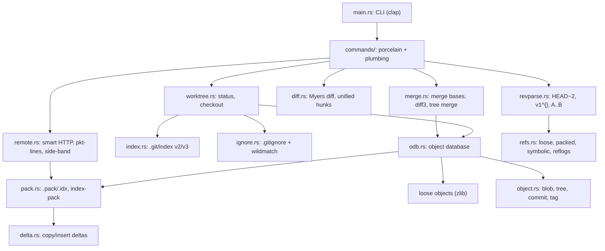

# twig: a Git implementation in Rust

[](https://github.com/pMag11-alt/twig/actions/workflows/ci.yml)


twig is a version control system that speaks Git's on-disk formats and network protocol. It works
on real repositories: you can clone from GitHub with twig, commit with twig, and switch back to
`git` at any point. Both tools see the same objects, index, refs and history, and `git fsck
--strict` finds nothing to complain about.

Everything Git-specific is written from scratch in about 7,000 lines of Rust. That covers the
object model, packfiles and delta compression, the index, refs, Myers diff, three-way merge,
`.gitignore` matching and the smart HTTP protocol. The crates it uses are for zlib, SHA-1, HTTPS,
argument parsing and memory-mapping files.

```console
$ twig clone https://github.com/BurntSushi/ripgrep
Cloning into 'ripgrep'...
remote: Enumerating objects: 14150, done.
remote: Counting objects: 100% (138/138), done.
remote: Compressing objects: 100% (71/71), done.
remote: Total 14150 (delta 92), reused 67 (delta 67), pack-reused 14012 (from 4)
Receiving objects: 5.7 MiB, done.
Resolving objects: 100% (14150/14150), done.
Received 14150 objects; checked out 'master'.

$ cd ripgrep
$ git fsck --strict && git status --short     # git is happy with what twig wrote
$ twig log --oneline -3
6892bc2 (HEAD -> master, origin/master) ignore: use byte keys for incremental parent lookups
1752fb7 globset: reject impossible literal lengths before hashing
2d4fa85 ignore: skip empty absolute parent matchers (#3557)
```

## Features

| Area | Commands |
| --- | --- |
| Everyday work | `init`, `add`, `rm`, `status`, `commit` (`-a`, `--amend`), `log`, `show`, `diff` (`--cached`, `--stat`, commit ranges) |
| Branching | `branch` (`-d`, `-D`, `-m`, `-v`), `switch` (`-c`, `--detach`), `checkout` (branches, commits or files), `restore`, `reset` (`--soft`, `--mixed`, `--hard`), `tag` (lightweight and annotated) |
| Merging | `merge`: fast-forward, or a true three-way merge with conflict markers and conflict stages in the index; `merge --abort` |
| Remotes | `clone`, `fetch` and `pull` over HTTPS (Git's smart protocol, as GitHub speaks it) or from a local path |
| Plumbing | `hash-object`, `cat-file`, `ls-tree`, `ls-files`, `write-tree`, `commit-tree`, `rev-parse`, `merge-base`, `config` |

It also reads and writes:

- **loose objects** and **packfiles** with OFS_DELTA and REF_DELTA compression, and the v2
  `.idx` pack index, which twig both reads and generates for packs it downloads
- the **binary index** (`.git/index`, versions 2 and 3), including conflict stages, with Git's
  "racily clean" protection
- **refs**: loose and packed, symbolic and detached, plus reflogs
- **revision syntax**: `HEAD~3`, `main^2`, `v1.0^{}`, `HEAD:src/main.rs`, abbreviated ids and `A..B`
  ranges
- **`.gitignore`**, with Git's own `wildmatch` semantics: `**`, character classes, negation and
  directory-only patterns
- the **config** format, which twig can also edit in place

## A short session

```console
$ twig init -q
$ twig add app.py && twig commit -m "Add greeting"
[main (root-commit) e3eb4ef] Add greeting
 1 file changed, 2 insertions(+)
 create mode 100644 app.py
$ twig switch -c shout          # edit app.py, then commit -am "Shout"
$ twig switch main              # edit the same line differently, commit -am "Greet the world"
$ twig merge shout
Auto-merging app.py
CONFLICT (content): Merge conflict in app.py
Automatic merge failed; fix conflicts and then commit the result.
$ cat app.py
def greet():
<<<<<<< HEAD
    return "hello, world"
=======
    return "HELLO"
>>>>>>> shout
$ twig status
On branch main

You have unmerged paths.
  (fix conflicts and run "twig commit")
  (use "twig merge --abort" to abort the merge)

Unmerged paths:
  (use "twig add <file>..." to mark resolution)
	both modified:   app.py
$ # fix the file, then:
$ twig add app.py && twig commit -q -m "Merge shout"
$ twig log --oneline
71e7ea3 (HEAD -> main) Merge shout
d019c81 Greet the world
331507b (shout) Shout
e3eb4ef Add greeting
```

## Install

```bash
git clone https://github.com/pMag11-alt/twig.git
cd twig
cargo install --path .        # or: cargo build --release && ./target/release/twig
```

It needs a recent stable Rust toolchain (2024 edition), and runs on Linux and macOS.

## How it works



Some of the more interesting pieces:

- **Content-addressed storage.** Every object is stored as `"<type> <size>\0<data>"`, named by
  its SHA-1 hash and zlib-compressed. Trees sort entries the way Git does, so a directory `foo`
  sorts as `foo/`, after `foo.c`. That detail matters: get it wrong and the tree ids no longer
  match Git's.
- **Packfiles.** A pack is a sequence of zlib streams with no length prefixes, so the only way to
  find where an entry ends is to inflate it. A delta entry stores a list of copy and insert
  instructions against a base object, which is found either by offset within the pack or by
  object id. For clones, twig indexes the received pack the way `git index-pack` does. It hashes
  base objects as it reads them, then walks from each base to the deltas that use it, so it only
  keeps the current delta chain in memory. Cloning tokio (4,829 commits) peaks at about 50 MB.
- **The smart HTTP protocol.** Cloning takes two requests. `GET info/refs` returns the remote's
  refs as pkt-lines, and `POST git-upload-pack` sends "want" (and, when fetching, "have") lines.
  The pack comes back multiplexed over side-band channels: pack data on channel 1, the server's
  progress messages on 2, and errors on 3.
- **Diff.** twig uses Myers' O(ND) algorithm in its linear-space, divide-and-conquer form:
  searching forwards and backwards at once finds a "middle snake", and then each half is diffed
  recursively. A property test checks against a brute-force LCS that the result is always a valid
  and shortest edit script.
- **Three-way merge.** It first finds the merge base, the best common ancestor, by walking history
  newest first. Then it merges trees path by path. Where both sides edited the same file, it runs
  a diff3 line merge. Conflicts get Git's markers in the work tree and stages 1, 2 and 3 in the
  index, so `git status` and merge tools understand them.
- **Status.** twig compares HEAD, the index and the work tree. To skip re-hashing unchanged files
  it trusts the cached stat data in the index, except for "racily clean" entries modified in the
  same instant the index was written. Directories that hold no tracked files collapse to `dir/`,
  as in Git.

## Testing against Git itself

```bash
cargo test                              # 54 tests
TWIG_NETWORK_TESTS=1 cargo test         # also clone from GitHub
```

There are 36 unit tests, covering for example the Myers property test, 68 cases adapted from
Git's own `wildmatch` test suite, delta decoding and index round trips. The other 18 integration
tests run twig and the real `git` side by side in throwaway repositories and compare the results:

- **Byte-identical commits**: building the same history with twig and with Git (same content,
  author and timestamps) gives the same commit ids.
- **Status through 120 random edits**: after every create, modify, delete, chmod, `add`, `rm
  --cached` or commit, `twig status --porcelain` must match `git status --porcelain` exactly.
- **Packed repositories**: Git builds a history and runs `git gc --aggressive` to produce delta
  chains and packed refs. Then twig's `cat-file -p` must match Git's for every object, and its
  `log` must match Git's.
- **Patches**: the output of `twig diff` must apply cleanly with `git apply` and reproduce the
  same tree.
- **Merges**: a clean merge done by twig produces exactly the tree `git merge` produces. A
  conflicted merge leaves the same file contents, `git status` and `git ls-files -s` output as
  Git's.
- **Clone, fetch and pull** from a local repository, and over HTTPS from GitHub. Each clone must
  pass `git fsck --strict` and have a clean `git status`.

CI runs everything on Linux and macOS, plus `clippy -D warnings` and `rustfmt`. It also runs a
self-hosting check: twig clones twig from GitHub, and git verifies the result.

## Not implemented

`push`, `rebase`, `stash`, rename detection, submodule checkout, the SSH transport, Git protocol
v2, shallow clones, and writing packfiles (local objects stay loose until `git gc` packs them).
Criss-cross merges with several merge bases use the most recent base instead of Git's recursive
virtual base.

## License

MIT
